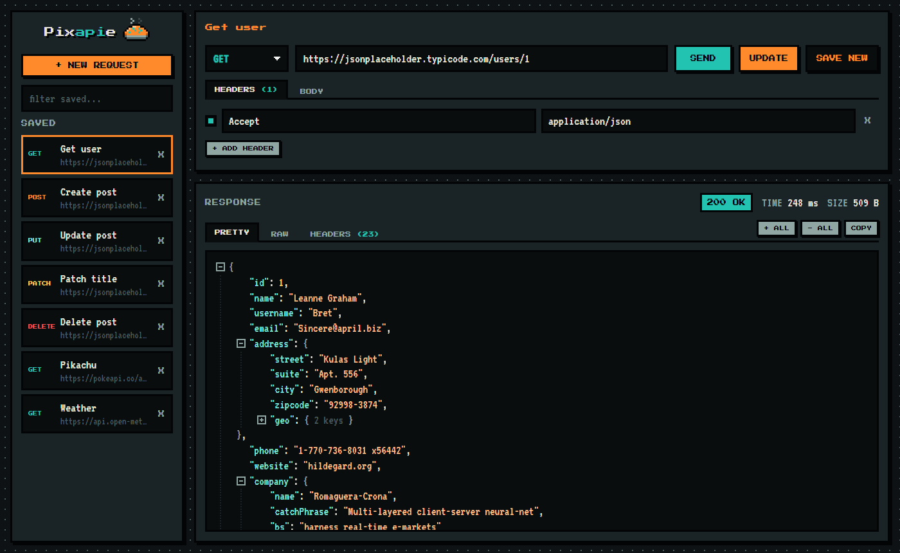

# Pixapie 🥧

A tiny, pixel-style API client that runs on your own machine. Send requests, save them for later, and explore JSON responses in a collapsible tree.

No accounts, no cloud, no dependencies. Your requests and API keys never leave your computer, except to go to the API you're calling.



## Quick start

You need [Node.js](https://nodejs.org) 18 or newer.

```sh
npx pixapie
```

That's it. Pixapie starts up and opens in your browser at http://localhost:3030.

### Or run from source

```sh
git clone https://github.com/Alpaca-Media-Limited/pixapie.git
cd pixapie
npm start
```

On Windows you can also double-click `start.bat`.

## Features

- **Every method:** GET, POST, PUT, PATCH, DELETE, HEAD, OPTIONS
- **Headers:** add, remove, or switch them on and off, with suggestions for common ones
- **Body:** JSON, text, XML, or form fields. The right `Content-Type` is set automatically unless you set your own
- **Saved requests:** save, update, save as new, filter, delete
- **JSON tree:** expand and collapse any level, or all at once. Raw view and response headers too
- **Status, time, and size** for every response

### Keyboard shortcuts

| Keys | Action |
|---|---|
| `Enter` (in the URL box) or `Ctrl+Enter` | Send |
| `Ctrl+S` | Save / update |
| `Ctrl+Shift+S` | Save as new |

## Options

| Setting | Default | What it does |
|---|---|---|
| `PORT` env variable | `3030` | Port to run on, e.g. `PORT=4000 npx pixapie` |
| `PIXAPIE_DATA` env variable | `~/.pixapie` | Folder where saved requests are kept |
| `--no-open` flag | off | Don't open the browser on start |

Saved requests are stored in plain JSON (`~/.pixapie/saved.json`), so they're easy to back up or share.

## How it works

Browsers block web pages from calling most APIs directly (CORS). So Pixapie runs a small local server that sends requests for you and serves the interface. The server:

- only listens on `127.0.0.1`, so nothing else on your network can reach it
- refuses requests from other websites open in your browser

**Pixapie is designed to run locally.** Don't expose it to the internet as-is: it would act as an open proxy for anyone who finds it.

## Using Pixapie offline

Everything works offline except the pixel fonts, which load from Google Fonts. Without them it falls back to your system's monospace font.

## License

[MIT](LICENSE) © 2026 Alpaca Media Ltd
